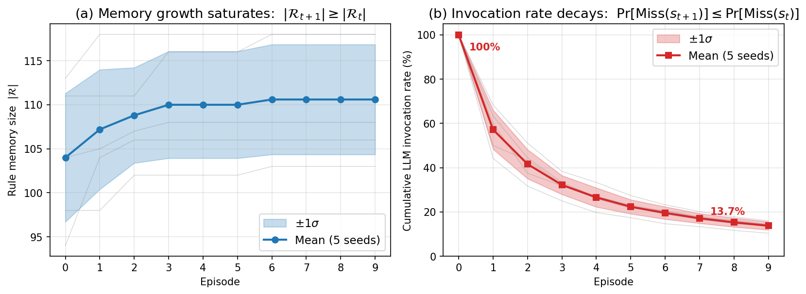

# REINS: A Self-Evolving Agent Harness for Real-Time Trajectory Planning

## Overview

This is the official implementation of **REINS**, a self-evolving agent harness that lets a large language model (LLM) act as a real-time trajectory planner for autonomous driving — without keeping the LLM in the millisecond-level control loop, and without any LLM weight update.

REINS extends the **agent-harness** paradigm (Claude Code, Codex, Cursor-Agent for software engineering) to safety-critical, sub-50 ms control. The harness wraps the LLM with a thin runtime layer that enforces three couplings between LLM and planner: *grounding*, *verification*, and *consolidation*. Together they close a self-evolution loop in which familiar scenes are served from memory in $\mathcal{O}(\log n)$ time and only novel scenes invoke the LLM, whose verified outputs enrich the memory for the next encounter.

<p align="center">
<table>
  <tr>
    <td align="center">
      
      <br><em>Highway Scenario</em>
    </td>
    <td align="center">
      
      <br><em>Merge Scenario</em>
    </td>
  </tr>
  <tr>
    <td align="center">
      
      <br><em>Roundabout Scenario</em>
    </td>
    <td align="center">
      
      <br><em>Intersection Scenario</em>
    </td>
  </tr>
</table>
</p>

## Why a harness?

Existing LLM-based trajectory planners sit at two extremes:

- **Runtime invocation** keeps the LLM in the loop but exceeds the millisecond control budget by orders of magnitude.
- **Offline extraction** discards the LLM at runtime, freezing the planner against scenarios the offline corpus did not anticipate.

Hybrid designs partially orchestrate the LLM but stop short of a full harness: they lack explicit verification of LLM commitments and consolidation of verified ones into reusable structure. REINS makes these two missing pieces — together with grounding — explicit and operationalizes them as a runtime around the LLM.

## Three couplings

| Coupling | What it solves | How REINS realizes it |
|----------|---------------|-----------------------|
| **Grounding** | LLM utterances ("keep a safe distance") must align with physical state variables (TTC, THW, DHW, …) | A learned **world dynamics model** — group-weighted ridge regression for parent selection (LLM edge priors fused with data) plus a per-variable Transformer for evolution. |
| **Verification** | Stochastic LLM outputs must be filtered before they reach control | LLM-proposed maneuvers compile into **calibrated predicates** (z-score / quantile / absolute thresholds); only commitments whose H-step rollout under the dynamics model satisfies all guards are released. |
| **Consolidation** | Per-call LLM latency must be amortised across recurring scenes | Verified commitments are persisted in an **indexed rule memory** (Neo4j), keyed by grounding variables, retrieved in $\mathcal{O}(\log n)$ via parameterised Cypher queries. |

The three are jointly necessary: without grounding, verification has nothing to check; without verification, consolidation stores unverified content; without consolidation, every scene re-pays the LLM latency.

## Architecture

REINS runs as a two-phase system.

**Phase 1 — Offline preparation** (`src/world_model/`, `src/rule_system/`)
1. *World dynamics learning*: discover dependency graph $\hat{\mathcal{G}}$ and fit per-variable Transformer dynamics $\hat{\mathcal{F}}$.
2. *Rule compilation*: prompt the LLM along each edge of $\hat{\mathcal{G}}$ to emit rule structures over 7 templates, calibrate predicate thresholds against logged trajectories, store the compiled rules in Neo4j as the initial rule memory $\mathcal{R}_0$.

**Phase 2 — Online runtime** (`src/planning/`, `src/rule_system/`, `src/llm/`)
1. *Scene-aware retrieval*: parameterised Cypher queries pull rules whose triggers match the current scene's active variables.
2. *Rule-based action scoring*: a Transformer scorer ranks candidate actions; multiple rules per action are aggregated via noisy-OR.
3. *Trajectory verification*: top-$M$ candidates are rolled out $H$ steps under $\hat{\mathcal{F}}$; the action with the best penalty-aware return is executed in receding-horizon.
4. *Online rule acquisition* (memory miss): a miss is declared when no rule is retrieved or when the current scene is novel (max cosine similarity against a sliding window of recent states falls below a threshold $\gamma$). On a miss, the LLM proposes a new rule, which is rolled out under $\hat{\mathcal{F}}$; only if every predicate holds along the rollout is the rule written back to $\mathcal{R}$, keyed by a content hash that averages confidence on collision.

The miss-handling path is what closes the **self-evolution loop**: as $\mathcal{R}$ matures, miss rate (and therefore LLM-call rate) decreases monotonically over deployment, with no LLM weight update.

## Results

Headline numbers across four simulated scenarios and two real-world datasets:

| Scenario | Compliance ↑ | Risk-aware Efficiency ↑ | Collision Rate ↓ | Planning Time ↓ |
|----------|--------------|--------------------------|-------------------|------------------|
| Highway | 99.56% | 0.52 | 5.67% | 2.50 ms |
| Merge | 99.24% | -0.04 | 6.86% | 1.89 ms |
| Roundabout | 99.25% | -0.54 | 9.01% | 3.62 ms |
| Intersection | 98.38% | -0.57 | 9.08% | 4.58 ms |
| highD (real) | 98.67% | 0.38 | 6.12% | 2.62 ms |
| rounD (real) | 98.56% | -0.41 | 9.45% | 3.89 ms |

**Highlights**
- 98%+ rule compliance across all scenarios.
- ≈50% collision-rate reduction versus the strongest baseline.
- 1.9–4.6 ms per-step planning time — well within a 50 ms (20 Hz) control budget, and up to 58% faster than runtime-LLM baselines.
- First empirical evidence of self-evolution in real-time LLM trajectory planning: monotonic decrease of LLM-call rate over deployment.

<p align="center">
  
</p>

*Self-evolution dynamics (5 seeds, mean ± 1σ).* As deployment proceeds, the rule memory $\mathcal{R}$ grows and then saturates **(a)**, while the cumulative LLM-invocation rate decays monotonically from 100% (cold start) to ~14% **(b)** — recurring scenes are increasingly served by memory lookup, so the harness invokes the LLM only on genuinely novel scenes, with no LLM weight update.

## Installation

### Prerequisites
- Python 3.10+
- CUDA-compatible GPU (recommended)
- Neo4j Database 5.12+

### Environment Setup

```bash
# Create conda environment
conda create -n reins python=3.10
conda activate reins

# Install PyTorch for your CUDA version first (see https://pytorch.org/get-started/locally/)
pip install torch

# Install the remaining dependencies
pip install -r requirements.txt
```

`torch-geometric` is only needed for the optional GNN dynamics model (`structure_model: "gnn"`).

### Configuration

1. Copy the env template and fill in your values:
   ```bash
   cp .env.example .env
   ```
2. Edit `.env`:
   ```
   OPENAI_API_KEY="your-openai-api-key"
   NEO4J_PASSWORD="your-neo4j-password"
   ```
3. Start a Neo4j instance reachable on `bolt://localhost:7687`.

**LLM backend.** The rule memory reported in the paper was compiled with `gpt-4o`. The model used by the code is set in `config/config.py` (`openai_engine`, offline rule extraction) and `config/inference_runner.yaml` (`llm.model`, online acquisition); change both to the model you want to reproduce.

## Usage

The pipeline is driven by `src/pipeline/main.py`, which exposes three stages.

### Offline preparation (training)

Sample episodes, learn $\hat{\mathcal{G}}$ and $\hat{\mathcal{F}}$, compile $\mathcal{R}_0$, and train the rule scorer:

```bash
python src/pipeline/main.py --stage train --num_train_episodes 30
```

This runs:
1. **Sampling**: collect trajectories from driving environments.
2. **Structure learning**: fuse LLM edge priors with ridge-regression-based parent selection.
3. **Dynamics training**: train per-variable Transformer dynamics.
4. **Rule extraction**: prompt the LLM along each discovered edge.
5. **Threshold calibration**: z-score / quantile / absolute, with operator chosen for safety separability.
6. **Scorer training**: train the rule relevance + action scorer.

### Online runtime (inference)

Run rule-guided planning with the trained models, with online rule acquisition on memory misses:

```bash
python src/pipeline/main.py --stage inference \
    --num_test_episodes 3 \
    --config config/inference_runner.yaml
```

Outputs (organised by scenario, e.g. `Highway/`, `Merge/`, `Roundabout/`, `Intersection/`):
- `result/videos/<timestamp>/episode-*.mp4` — recorded rollouts.
- `result/inference/<Scenario>/inference_results.json` — per-episode metrics, including `llm_invocation_rate` and `acquired_rules_count` from the self-evolution loop.
- `result/inference/<Scenario>/episode_metrics.csv`, `step_metrics.csv` — flattened metrics.
- `result/inference/<Scenario>/*.png` — plots from `visualize_inference_results`.

### End-to-end

```bash
python src/pipeline/main.py --stage all
```

### Configuration options

Edit `config/config.py` for global settings:

```python
CONFIG = {
    "env_name": "merge-v0",           # highway-v0, merge-v0, roundabout-v0, intersection-v1
    "num_train_episodes": 100,
    "structure_model": "transformer", # mlp, transformer, gnn
    "rule_scorer": "transformer",
    "output_dir": "result/",
    "seed": 42,
}
```

## Supported scenarios

| Scenario | Description | Complexity |
|----------|-------------|------------|
| `highway-v0` | Straight lanes, car-following | Low |
| `merge-v0` | On-ramp joining | Medium |
| `roundabout-v0` | Curved multi-lane | Medium-High |
| `intersection-v1` | Multi-way crossing with right-of-way | High |

Real-world datasets: **highD** (German highway) and **rounD** (German roundabouts). Both are distributed under their own licences and are not included here; request them from the [highD](https://www.highd-dataset.com/) and [rounD](https://www.round-dataset.com/) providers.

## Scope of this release

This repository contains the REINS harness (grounding, verification, consolidation, and the online acquisition loop) together with the four `highway-env` scenarios, sampled episodes, and the compiled rule memory $\mathcal{R}_0$. The closed-loop replay evaluation on highD/rounD and the baseline planners compared in the paper are not part of this release; see the paper for their sources and settings.

## Project structure

```
REINS/
├── README.md                        # Project documentation
├── LICENSE                          # Apache 2.0 License
├── requirements.txt                 # Python dependencies
├── .env.example                     # Environment variables template
├── config/                          # Configuration files
│   ├── config.py                    # Global configuration
│   ├── causal_graph.yaml            # Dependency graph specification
│   ├── variable_config.yaml         # Variable definitions (5 macro-groups)
│   ├── rule_index_definitions.yaml  # Rule indexing schema
│   ├── inference_runner.yaml        # Online runtime configuration
│   ├── prompt_templates.yaml        # LLM prompt templates
│   └── vocab.json                   # Vocabulary for rule encoding
├── data/
│   ├── samples/                     # Sampled trajectory episodes
│   │   ├── Highway/
│   │   ├── Intersection/
│   │   ├── Merge/
│   │   └── Roundabout/
│   ├── extracted_rules.json         # Compiled rule memory R_0
│   └── Merge_extracted_rules.json   # Scenario-specific rule pack (Merge)
├── src/
│   ├── world_model/                 # Grounding: dependency graph + dynamics
│   │   ├── causal_graph.py
│   │   ├── structure_learner.py     # LLM prior + ridge regression
│   │   └── dynamics/
│   │       ├── mlp.py
│   │       ├── transformer.py
│   │       └── gnn.py
│   ├── rule_system/                 # Consolidation + self-evolving rule memory
│   │   ├── extractor.py             # Offline LLM rule extraction (R_0)
│   │   ├── encoder.py               # Rule encoding
│   │   ├── scorer.py                # Relevance + action scorer
│   │   ├── engine.py                # Rule execution
│   │   ├── calibrator.py            # Offline threshold calibration
│   │   ├── acquirer.py              # Online rule acquisition loop (Section 3.2.2)
│   │   └── storage.py               # Neo4j-backed indexed memory
│   ├── planning/                    # Verification + control
│   │   ├── planner.py               # H-step rollout + receding horizon
│   │   └── retriever.py             # Scene-aware Cypher retrieval
│   ├── llm/
│   │   ├── caller.py                # LLM API caller
│   │   └── prompts/                 # Prompt templates
│   ├── pipeline/
│   │   ├── main.py                  # Entry point
│   │   ├── train.py                 # Offline preparation
│   │   ├── train_scorer.py          # Rule-scorer training (standalone)
│   │   ├── inference.py             # Baseline runtime (no self-evolution)
│   │   ├── rule_inference.py        # Self-evolving runtime (default)
│   │   └── evaluate.py              # Metrics
│   └── utils/
│       ├── sampler.py
│       ├── visualization.py
│       ├── vocab_builder.py         # Rule-vocabulary builder
│       └── common.py
└── result/                          # Generated outputs (created at runtime; .gitignored)
    ├── checkpoints/                 # Trained dynamics, scorer, F_i models
    ├── inference/<Scenario>/        # inference_results.json, episode_metrics.csv, step_metrics.csv
    ├── figures/                     # Training and evaluation plots
    └── videos/                      # Episode rollouts (.mp4)
```

## Citation

If you use REINS in your research, please cite:

```bibtex
@inproceedings{cui2026reins,
  title     = {{REINS}: A Self-Evolving Agent Harness for Real-Time Trajectory Planning},
  author    = {Cui, Zhihong and Liu, Hengyu and Tang, Haoran and Liu, Shijun and Taherkordi, Amir and Skeie, Tor},
  booktitle = {Advances in Neural Information Processing Systems (NeurIPS)},
  year      = {2026}
}
```

## License

This project is licensed under the Apache License 2.0 — see the [LICENSE](LICENSE) file for details.

## Acknowledgments

- [highway-env](https://github.com/eleurent/highway-env) for driving simulation
- [Neo4j](https://neo4j.com/) for the graph database
- [highD](https://www.highd-dataset.com/) and [rounD](https://www.round-dataset.com/) datasets
